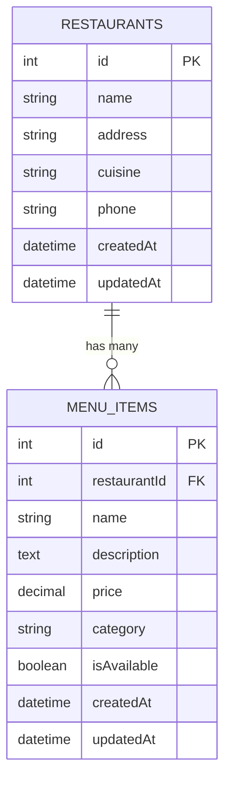

# Online Food Ordering System (25 Marks)
**Course:** CS-301L - Full Stack Web Development  
**Lab Task:** Quiz 01 - Q2  
**Student ID:** 242720  

---

## 🛠️ Tech Stack
- **Frontend:** HTML5, CSS3, Bootstrap 5.3, Vanilla JavaScript (DOM manipulation, Fetch API async/await)
- **Backend:** NestJS (Modules, Controllers, Services, Dependency Injection)
- **Database:** PostgreSQL with TypeORM
- **Validation:** `class-validator`, `class-transformer`, `ValidationPipe`
- **Security:** `ApiKeyGuard` (protecting menu item routes via `x-api-key` header)
- **Middleware:** `RequestLoggerMiddleware` (logging incoming HTTP requests, status, duration, IP)

---

## 📁 Project Architecture & Directory Structure

```
Online-food-ordering-system/
├── .env                              # Environment variables (DB credentials, API Key, Port)
├── .env.example                      # Template for environment variables
├── .gitignore                        # Git exclusion rules
├── package.json                      # Dependencies and npm scripts
├── tsconfig.json                     # TypeScript compiler configuration
├── tsconfig.build.json               # Build tsconfig
├── nest-cli.json                     # Nest CLI configuration
├── postman_collection.json           # Postman Collection for all APIs & tests
├── test-api.js                       # Automated API & Guard test script
├── public/                           # Frontend Assets (Served automatically by NestJS)
│   ├── index.html                    # Responsive Bootstrap 5 UI (Cards & Tables)
│   ├── css/
│   │   └── styles.css                # Custom modern styling
│   └── js/
│       └── app.js                    # Vanilla JS (async/await, validation, DOM manipulation)
└── src/
    ├── main.ts                       # App bootstrap, Global ValidationPipe, CORS, Static assets
    ├── app.module.ts                 # Root module, TypeORM connection, middleware registration
    ├── common/
    │   ├── guards/
    │   │   └── api-key.guard.ts      # Simple API-key header guard for menu-items
    │   └── middleware/
    │       └── logger.middleware.ts  # Request logger middleware
    ├── restaurants/
    │   ├── dto/
    │   │   └── create-restaurant.dto.ts
    │   ├── entities/
    │   │   └── restaurant.entity.ts  # One-to-Many relation with MenuItem
    │   ├── restaurants.controller.ts # GET /restaurants, POST /restaurants
    │   ├── restaurants.service.ts    # TypeORM repository injection
    │   └── restaurants.module.ts
    └── menu-items/
        ├── dto/
        │   ├── create-menu-item.dto.ts # Validates non-empty name & positive price
        │   └── update-menu-item.dto.ts
        ├── entities/
        │   └── menu-item.entity.ts   # Many-to-One relation with Restaurant
        ├── menu-items.controller.ts  # Full CRUD: GET, GET/:id, POST, PATCH/:id, DELETE/:id
        ├── menu-items.service.ts     # TypeORM repository injection
        └── menu-items.module.ts
```

---

## 🗄️ Database Relationships



- **One-to-Many:** `Restaurant.menuItems` &rarr; A restaurant has many menu items (`cascade: true`).
- **Many-to-One:** `MenuItem.restaurant` &rarr; Each menu item belongs to one restaurant (`onDelete: 'CASCADE'`).

---

## 🚀 How to Run the Project

### 1. Database Setup in PostgreSQL
1. Ensure your PostgreSQL service is running on `localhost:5432`.
2. In pgAdmin or `psql`, create the database `food_ordering_db`:
   ```sql
   CREATE DATABASE food_ordering_db;
   ```
3. TypeORM will automatically synchronize the tables (`restaurants` and `menu_items`) upon startup!

### 2. Configure Environment (`.env`)
Make sure your `.env` contains:
```env
PORT=3000
API_KEY=food-quiz-secret-key-2026

DB_HOST=localhost
DB_PORT=5432
DB_USERNAME=postgres
DB_PASSWORD=postgres
DB_NAME=food_ordering_db
DB_SYNCHRONIZE=true
DB_LOGGING=false
```

### 3. Install Dependencies
```bash
npm install
```

### 4. Start the Application
```bash
npm run start:dev
```
- Server starts at: `http://localhost:3000`
- Open your browser at: `http://localhost:3000` to interact with the responsive Bootstrap frontend!

---

## 🧪 Testing APIs & Features

### 1. Automated Test Script
In a separate terminal, execute:
```bash
npm run test:api
```
This tests:
- `POST /restaurants` & `GET /restaurants`
- `ApiKeyGuard` rejection (401 Unauthorized when missing or wrong key)
- `ValidationPipe` rejection (400 Bad Request when name is empty or price <= 0)
- `POST /menu-items` (creation with valid foreign key)
- `GET /menu-items/:id` & `PATCH /menu-items/:id` & `DELETE /menu-items/:id`
- Database One-to-Many relationship verification

### 2. Testing with Postman
1. Open Postman &rarr; **Import** &rarr; Select `postman_collection.json`.
2. Set the `baseUrl` variable to `http://localhost:3000`.
3. Set the `apiKey` variable to `food-quiz-secret-key-2026`.
4. Test:
   - **GET /restaurants** and **POST /restaurants** (No API key needed)
   - **Menu Items endpoints** with header `x-api-key: food-quiz-secret-key-2026`
   - Test Guard rejection by disabling the `x-api-key` header to receive `401 Unauthorized`.
   - Test DTO validation by posting empty name or negative price to receive `400 Bad Request`.

---

## 🔑 Security & Middleware Details
1. **Request Logger Middleware:**
   - Intercepts all incoming HTTP requests.
   - Outputs: `[METHOD] /path | Status: 200 | 12ms | IP: ...`
2. **API Key Guard (`ApiKeyGuard`):**
   - Applied to `/menu-items` controller via `@UseGuards(ApiKeyGuard)`.
   - Validates the `x-api-key` header against the environment `API_KEY`.
   - Rejects unauthorized requests with `401 Unauthorized`.
